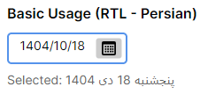
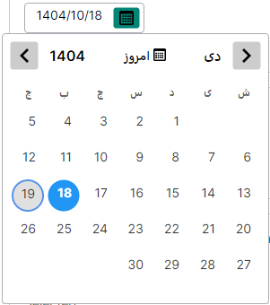

<div align="center">


# ModernPersianDatePicker

</div>

A modern, fully-featured Persian (Jalali/Shamsi) DatePicker control for **Avalonia UI**, inspired by the popular [FarsiLibrary](https://github.com/HEskandari/FarsiLibrary) for WPF/WinForms.


## Features

- ✅ **Full Persian Calendar Support** - Accurate Jalali/Shamsi date calculations with leap year support
- ✅ **RTL & LTR Layouts** - Right-to-left for Persian, Left-to-right for English
- ✅ **Multi-Language Support** - Farsi, English, Arabic, Kurdish + custom via `ICalendarLocalization`
- ✅ **Calendar Type** - Persian, Gregorian, or Auto-detect from thread culture
- ✅ **Keyboard Navigation** - Full keyboard support for accessibility
- ✅ **Mouse Scroll Navigation** - Scroll through months with mouse wheel when calendar is open
- ✅ **Editable Mode** - Type dates manually with validation
- ✅ **Month/Year Selection** - Quick dropdown selectors for month and year
- ✅ **Today Button** - Quick access to current date
- ✅ **Time Picker** - Optional Hour/Minute/Second spinners exposed as a single `SelectedTime` (`TimeSpan`)
- ✅ **Date Range Picker** - Select start and end dates, with optional `RangeStartTime` / `RangeEndTime` time-of-day components
- ✅ **Quick Range Panel** - Custom-designed preset picker (Today / Week / Month / Year + grouped Month/Season/Half-Year) with optional From/To time spinners
- ✅ **Weekly Holidays** - Configurable `DayOfWeek` recurring holidays
- ✅ **Specific Date Holidays** - Mark individual dates as holidays with custom brush
- ✅ **Custom Accent Brush** - Override the theme accent for selected day, today border, etc.
- ✅ **Light/Dark Theme** - Per-instance theme mode (System/Light/Dark) or app-wide
- ✅ **Min/Max Date Validation** - Restrict date range
- ✅ **Multiple Date Formats** - Long, short, and month display formats
- ✅ **Modern UI** - Beautiful styling with hover effects and visual feedback
- ✅ **MVVM Ready** - Full data binding support with compiled bindings

## Installation

### Option 1: Clone the Repository
```bash
git clone https://github.com/raminmjj/ModernPersianDatePicker.git
cd ModernPersianDatePicker
```

### Option 2: Add as Project Reference
1. Clone or download the repository
2. Add reference to your Avalonia project:
```xml
<ProjectReference Include="..\ModernPersianDatePicker\ModernPersianDatePicker.csproj" />
```

### Option 3: NuGet Package
```bash
dotnet add package ModernPersianDatePicker
```

## Quick Start

### 1. Add Styles to App.axaml
```xml
<Application xmlns="https://github.com/avaloniaui"
             xmlns:x="http://schemas.microsoft.com/winfx/2006/xaml"
             x:Class="YourApp.App"
             xmlns:persian="using:ModernPersianDatePicker">
    <Application.Styles>
        <FluentTheme />
        <StyleInclude Source="avares://ModernPersianDatePicker/Themes/ModernPersianDatePickerTheme.xaml"/>
    </Application.Styles>
</Application>
```

### 2. Use in Your XAML
```xml
<Window xmlns="https://github.com/avaloniaui"
        xmlns:x="http://schemas.microsoft.com/winfx/2006/xaml"
        xmlns:persian="using:ModernPersianDatePicker"
        x:Class="YourApp.MainWindow">
    
    <StackPanel Margin="20">
        <!-- Basic Usage (Persian, RTL) -->
        <persian:ModernPersianDatePicker 
            Width="250"
            Margin="0,10"/>
        
        <!-- English Language (LTR) -->
        <persian:ModernPersianDatePicker 
            Language="English"
            FlowDirection="LeftToRight"
            Width="250"
            Margin="0,10"/>
        
        <!-- Editable Mode -->
        <persian:ModernPersianDatePicker 
            IsEditable="True"
            InvalidValueAction="SetToToday"
            Width="250"
            Margin="0,10"/>
        
        <!-- With Date Range -->
        <persian:ModernPersianDatePicker 
            MinDate="1400/01/01"
            MaxDate="1410/12/29"
            Width="250"
            Margin="0,10"/>

        <!-- Time Picker -->
        <persian:ModernPersianDatePicker 
            IsTimePickerEnabled="True"
            Width="250"
            Margin="0,10"/>

        <!-- Date Range Picker -->
        <persian:ModernPersianDatePicker 
            IsRangeMode="True"
            Width="250"
            Margin="0,10"/>

        <!-- Date Range Picker with Time
             The parent's own TimePicker is hidden in range mode; time-of-day
             for the range is captured inside the From/To pickers shown in the
             Quick Range panel (open via the 'Quick Range' button). -->
        <persian:ModernPersianDatePicker 
            IsRangeMode="True"
            IsTimePickerEnabled="True"
            Width="250"
            Margin="0,10"/>

        <!-- Custom Accent & Gregorian Calendar -->
        <persian:ModernPersianDatePicker 
            CalendarType="Gregorian"
            Language="English"
            AccentBrush="#FF4CAF50"
            Width="250"
            Margin="0,10"/>
    </StackPanel>
</Window>
```

## Properties

| Property | Type | Default | Description |
|----------|------|---------|-------------|
| `SelectedDate` | `PersianDate?` | `null` | The selected Persian date |
| `DisplayFormat` | `string` | `"long"` | Date display format (`"long"`, `"short"`, `"month"`) |
| `Language` | `CalendarLanguage` | `Farsi` | Calendar language (Farsi, English, Arabic, Kurdish) |
| `CalendarType` | `CalendarType` | `Auto` | Calendar system (Auto, Persian, Gregorian) |
| `IsEditable` | `bool` | `false` | Allow manual date typing |
| `InvalidValueAction` | `InvalidValueAction` | `SetToNull` | Action for invalid input |
| `MinDate` | `PersianDate?` | `null` | Minimum selectable date |
| `MaxDate` | `PersianDate?` | `null` | Maximum selectable date |
| `Watermark` | `string` | `"Select date..."` | Placeholder text |
| `Theme` | `ThemeMode` | `System` | Per-instance theme (System, Light, Dark) |
| `AccentBrush` | `IBrush?` | `null` | Override accent color for selection and focus |
| `HolidayBrush` | `IBrush?` | `null` | Override color for holiday day numbers |
| `WeeklyHolidays` | `IReadOnlyList<DayOfWeek>` | `[Friday]` | Days of week treated as holidays |
| `Holidays` | `IReadOnlyList<PersianDate>` | `[]` | Specific dates to mark as holidays |
| `IsTimePickerEnabled` | `bool` | `false` | Show time picker spinners below calendar (single-date mode) or inside the Quick Range From/To pickers (range mode) |
| `SelectedTime` | `TimeSpan` | `00:00:00` | Selected time-of-day `[00:00:00, 23:59:59]` (single-date mode) |
| `IsRangeMode` | `bool` | `false` | Enable date range selection |
| `RangeStart` | `PersianDate?` | `null` | Start of selected range |
| `RangeEnd` | `PersianDate?` | `null` | End of selected range |
| `RangeStartTime` | `TimeSpan` | `00:00:00` | Time-of-day for range start (active when `IsRangeMode && IsTimePickerEnabled`) |
| `RangeEndTime` | `TimeSpan` | `23:59:59` | Time-of-day for range end (active when `IsRangeMode && IsTimePickerEnabled`) |
| `LocalizationProvider` | `ICalendarLocalization?` | `null` | Custom localization provider |

## Events

### `SelectedDateChanged`
Fired when the selected date changes.

```csharp
datePicker.SelectedDateChanged += (sender, e) =>
{
    if (e.NewDate.HasValue)
    {
        Console.WriteLine($"Selected: {e.NewDate.Value.ToString("long")}");
    }
};
```

### `DateRangeSelected`
Fired when a date range is fully selected (in `IsRangeMode`). The event args also carry the
current `StartTime` / `EndTime` (`TimeSpan`) — defaults are `00:00:00` and `23:59:59`.

```csharp
datePicker.DateRangeSelected += (sender, e) =>
{
    if (e.RangeStart is { } start && e.RangeEnd is { } end)
    {
        Console.WriteLine($"Range: {start:short} {e.StartTime:hh\:mm\:ss}" +
            $" ~ {end:short} {e.EndTime:hh\:mm\:ss}");
    }
};
```

### `SelectedTimeChanged`
Fired when the single-date `SelectedTime` changes (e.g. user spins the Hour/Minute/Second control).

```csharp
datePicker.SelectedTimeChanged += (sender, e) =>
{
    Console.WriteLine($"Time: {e.OldTime:hh\:mm\:ss} -> {e.NewTime:hh\:mm\:ss}");
};
```

### `RangeTimeChanged`
Fired when `RangeStartTime` or `RangeEndTime` changes — e.g. when the user adjusts the From/To
time spinners inside the Quick Range panel.

```csharp
datePicker.RangeTimeChanged += (sender, e) =>
{
    Console.WriteLine($"Range time: {datePicker.RangeStartTime:hh\:mm\:ss}" +
        $" ~ {datePicker.RangeEndTime:hh\:mm\:ss}");
};
```

## Keyboard & Mouse Navigation

When the calendar is open, use these keys and mouse actions:

| Key | Action |
|-----|--------|
| `←` (Left) | Next day / Next month (at month end) |
| `→` (Right) | Previous day / Previous month (at month start) |
| `↑` (Up) | Previous week / Previous month (same weekday) |
| `↓` (Down) | Next week / Next month (same weekday) |
| `PageUp` | Previous month |
| `PageDown` | Next month |
| `Home` | First day of month |
| `End` | Last day of month |
| `Space` / `Enter` | Select focused day |
| `Escape` | Close calendar |
| `Mouse Scroll Up` | Previous month |
| `Mouse Scroll Down` | Next month |

## Editable Mode

When `IsEditable="True"`, users can type dates manually:

### Supported Formats
```
1404/10/18    ✓ Slash separator
1404-10-19    ✓ Dash separator
1404_10_20    ✓ Underscore separator
04/10/21      ✓ 2-digit year (→ 1404)
```

### Invalid Value Actions

```csharp
// Set to null if invalid
InvalidValueAction="SetToNull"

// Set to today if invalid
InvalidValueAction="SetToToday"

// Keep current value if invalid
InvalidValueAction="Keep"
```

## Localization

Built-in languages: **Farsi**, **English**, **Arabic**, **Kurdish**.

To add a custom language, implement `ICalendarLocalization`:

```csharp
public class MyLocalization : ICalendarLocalization
{
    public string[] MonthNames => new[] { "Month1", "Month2", /* ... */ };
    public string[] DayNames => new[] { "Day1", "Day2", /* ... */ };
    public string[] ShortMonthNames => new[] { "M1", "M2", /* ... */ };
    public string[] ShortDayNames => new[] { "D1", "D2", /* ... */ };
}

// Use it:
datePicker.LocalizationProvider = new MyLocalization();
```

## Theming

### App-Wide Theme
```xml
<Application RequestedThemeVariant="Dark">
```

### Per-Instance Theme
```xml
<persian:ModernPersianDatePicker Theme="Dark" />
```

### Custom Accent
```xml
<persian:ModernPersianDatePicker AccentBrush="#FF4CAF50" />
```

## Holidays

### Weekly Holidays
```csharp
// Friday + Saturday (Persian weekend)
datePicker.WeeklyHolidays = new[] { DayOfWeek.Friday, DayOfWeek.Saturday };
```

### Specific Date Holidays
```csharp
datePicker.Holidays = new[]
{
    new PersianDate(1405, 1, 1, 1),   // Nowruz
    new PersianDate(1404, 9, 30, 2), // Yalda Night
};
```

### Custom Holiday Brush
```xml
<persian:ModernPersianDatePicker HolidayBrush="#FFFF8800" />
```

## Time & Range Time

### Single-date mode
Set `IsTimePickerEnabled="True"` to display Hour/Minute/Second spinners below the calendar.
The selected time-of-day is exposed as `SelectedTime` (`TimeSpan`, range `[00:00:00, 23:59:59]`).

```xml
<persian:ModernPersianDatePicker IsTimePickerEnabled="True" />
```

```csharp
TimeOnly time = TimeOnly.FromTimeSpan(datePicker.SelectedTime);
// Use ToDateTimeAsGregorian() when the picker is in Gregorian mode
var d = datePicker.SelectedDate!.Value;
DateTime full = (datePicker.CalendarType == CalendarType.Gregorian
    ? d.ToDateTimeAsGregorian() : d.ToDateTime()) + datePicker.SelectedTime;
```

### Range mode
When both `IsRangeMode` and `IsTimePickerEnabled` are `True`, the parent picker's own TimePicker
is **hidden** — the time-of-day for the range is instead captured inside the From/To pickers
shown in the Quick Range panel (open via the "Quick Range" button at the bottom of the dropdown).

The two times are surfaced on the parent picker as `RangeStartTime` (default `00:00:00`) and
`RangeEndTime` (default `23:59:59`).

```xml
<persian:ModernPersianDatePicker
    IsRangeMode="True"
    IsTimePickerEnabled="True" />
```

```csharp
datePicker.DateRangeSelected += (_, e) =>
{
    DateTime start = e.RangeStart!.Value.ToDateTime() + e.StartTime;
    DateTime end   = e.RangeEnd  !.Value.ToDateTime() + e.EndTime;
    Console.WriteLine($"[{start:yyyy-MM-dd HH:mm:ss} .. {end:yyyy-MM-dd HH:mm:ss}]");
};
```

> When the picker is in Gregorian mode, use `e.RangeStart.Value.ToDateTimeAsGregorian()`
> instead of `ToDateTime()` to avoid routing through `PersianCalendar` (which would reject
> days > 30 for Persian month 7 / Mehr).

### Visibility matrix

| Mode | Parent's TimePicker | Quick Range From/To TimePickers |
|------|---------------------|---------------------------------|
| Single-date, no time | hidden | hidden |
| Single-date, with time | **visible** | hidden |
| Range mode, no time | hidden | hidden |
| **Range mode + time** | **hidden** | **visible** |

## Gregorian Calendar Mode

```xml
<persian:ModernPersianDatePicker 
    CalendarType="Gregorian"
    Language="English"
    FlowDirection="LeftToRight" />
```

## Helper Classes

### `PersianCalendarHelper`
Utility class for Persian date operations:

```csharp
// Convert Gregorian to Persian
var persianDate = PersianCalendarHelper.ToPersianDate(DateTime.Today);

// Convert Persian to Gregorian (assumes the struct holds Persian values)
var gregorianDate = persianDate.ToDateTime();

// Construct a DateTime directly from a PersianDate struct whose
// Year/Month/Day are ALREADY Gregorian (i.e. the picker is in Gregorian mode).
// Use this when CalendarType == Gregorian — ToDateTime() would otherwise route
// through PersianCalendar and throw for e.g. July 31st (Persian month 7 / Mehr
// only has 30 days).
var dt = pickedDate.ToDateTimeAsGregorian();

// Get today's Persian date
var today = PersianCalendarHelper.Today();

// Check leap year
bool isLeap = PersianCalendarHelper.IsLeapYear(1404);

// Get days in month
int days = PersianCalendarHelper.GetDaysInMonth(1404, 12);

// Get month/day names
string monthName = PersianCalendarHelper.GetMonthName(1, useEnglish: false); // "فروردین"
string dayName = PersianCalendarHelper.GetDayName(0, useEnglish: false);    // "شنبه"

// Get today's date in the active calendar system (resolves Auto via culture)
var today = PersianCalendarHelper.TodayForCalendarType(datePicker.CalendarType);

// Get two mid-week days (Tue & Wed) of the current month in the active calendar
PersianDate[] midWeek = PersianCalendarHelper.GetMidWeekDaysOfCurrentMonth(datePicker.CalendarType);

// Format a date with calendar-aware day/month names
string formatted = PersianCalendarHelper.FormatPersianDate(date, "long", loc, CalendarType.Gregorian);
```

### `PersianDate`
Structure representing a Persian date:

```csharp
var date = new PersianDate(year: 1403, month: 10, day: 19, dayOfWeek: 6); // dayOfWeek: 0=Sat..6=Fri

// ToString formats
date.ToString();        // "1404/10/19"
date.ToString("long");  // "جمعه ۱۹ دی ۱۴۰۴"
date.ToString("short"); // "1404/10/19"
date.ToString("month"); // "دی ۱۴۰۴"

// Comparison
if (date1 > date2) { ... }
if (date1.CompareTo(date2) > 0) { ... }

// Convert to Gregorian (when the struct holds a Persian date)
DateTime gregorian = date.ToDateTime();

// Construct directly from the struct's values (when the struct holds a Gregorian date)
// Use this in Gregorian calendar mode to avoid PersianCalendar conversion errors.
DateTime asGregorian = date.ToDateTimeAsGregorian();

// Calendar-aware ToString — produces correct day/month names for both calendars
string farsi = date.ToString("long", loc, CalendarType.Persian);   // "شنبه 1 فروردین 1404"
string english = date.ToString("long", loc, CalendarType.Gregorian); // "Thursday 31 July 2025"
```

### `ModernPersianDatePicker` formatting helpers
The picker exposes three convenience methods that produce calendar-aware formatted
strings using the active localization and calendar type:

```csharp
string selected = datePicker.FormatSelectedDate("long");  // "شنبه 1 فروردین 1404"
string rangeStart = datePicker.FormatRangeStart("short");  // "1404/01/01"
string rangeEnd = datePicker.FormatRangeEnd("short");     // "1404/01/31"
```

These are especially useful in MVVM scenarios where the view-model needs to produce
display strings that respect the active calendar — without manually passing the
localization and calendar type to `PersianCalendarHelper.FormatPersianDate`.

## Demo Application

The solution includes a demo application showcasing all features, with three window variants:

- **MainWindow** - Code-behind style
- **MvvmWindow** - Manual MVVM (INotifyPropertyChanged + ICommand)
- **MvvmToolkitWindow** - CommunityToolkit.Mvvm ([ObservableProperty] + [RelayCommand])

```bash
cd demo/ModernPersianDatePicker.Demo
dotnet run
```

## Screenshots

### Persian (RTL) Mode



### Calendar View



## Requirements

- **.NET 8.0** or later
- **Avalonia UI 11.3.11** or later
- Windows, Linux, macOS support

## Building from Source

```bash
# Restore dependencies
dotnet restore

# Build library
dotnet build src/ModernPersianDatePicker

# Build demo
dotnet build demo/ModernPersianDatePicker.Demo

# Run demo
dotnet run --project demo/ModernPersianDatePicker.Demo

# Run tests
dotnet test
```

## Roadmap

- [x] Time picker component (`SelectedTime` as `TimeSpan`)
- [x] Date range picker with optional time-of-day (`RangeStartTime` / `RangeEndTime`)
- [x] Quick Range panel with grouped Month/Season/Half-Year presets
- [x] `SelectedTimeChanged` / `RangeTimeChanged` events
- [x] Gregorian-mode safe conversion (`ToGregorianDateTime` / `ToDateTimeAsGregorian`)
- [x] Calendar-aware date formatting (`FormatPersianDate` / `FormatSelectedDate` / `ToString(format, loc, calendarType)`)
- [x] Automatic date conversion when switching `CalendarType` (Persian ↔ Gregorian)
- [x] Calendar-aware "Today" button and initialization (`TodayForCalendarType`)
- [x] Custom themes
- [x] More localization options (Arabic, Kurdish + custom provider)
- [x] Gregorian calendar mode
- [x] Weekly & specific date holidays
- [x] Custom accent brush
- [x] Per-instance theme mode
- [x] MVVM demo windows

## Contributing

Contributions are welcome! Please feel free to submit a Pull Request.

1. Fork the repository
2. Create your feature branch (`git checkout -b feature/AmazingFeature`)
3. Commit your changes (`git commit -m 'Add some AmazingFeature'`)
4. Push to the branch (`git push origin feature/AmazingFeature`)
5. Open a Pull Request

## License

This project is licensed under the MIT License - see the [LICENSE](LICENSE) file for details.

## Acknowledgments

- Inspired by [HEskandari/FarsiLibrary](https://github.com/HEskandari/FarsiLibrary) for WPF/WinForms
- Built with [Avalonia UI](https://avaloniaui.net/)
- Vibe Coding with [Qwen Code CLI](https://qwenlm.github.io) & [MiMo](https://github.com/XiaomiMiMo/MiMo-Code) & [Super Z](https://chat.z.ai)
- Persian calendar algorithms based on standard Jalali calendar calculations

## Support

If you find this library helpful, please give it a ⭐️ star on GitHub!

**Issues & Questions:** [GitHub Issues](https://github.com/raminmjj/ModernPersianDatePicker/issues)

---

**Made with ❤️ for the Persian .NET Community**
